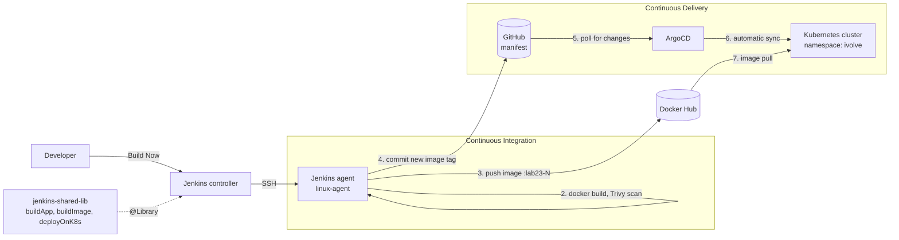
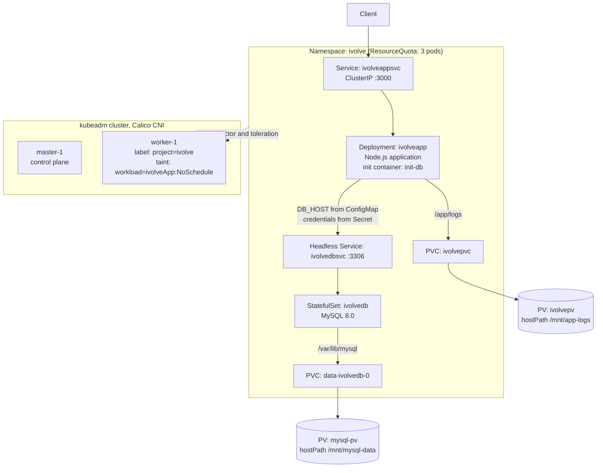

# Full CI/CD with GitOps Project

An end-to-end DevOps project that takes a Node.js and MySQL application from a local Docker Compose stack to a fully automated GitOps delivery pipeline on a self-built Kubernetes cluster.

Every stage is documented in its own folder with the exact commands, configuration files, and screenshots, so the whole project can be reproduced from the beginning.


## Overview

The project builds the delivery path of one application in five stages:

1. Run the application and its MySQL database with Docker Compose and publish the image to Docker Hub.
2. Build a two-node Kubernetes cluster from scratch with kubeadm.
3. Describe the application and the database as Kubernetes manifests.
4. Automate build, scan, and publish with a Jenkins pipeline that uses a shared library and a dedicated agent.
5. Deliver changes to the cluster with ArgoCD, using Git as the single source of truth.

The end result: a pipeline run builds a new image, scans it, pushes it, and commits the new image tag to Git. ArgoCD detects the commit and updates the cluster automatically. Nobody runs `kubectl apply`, and Jenkins holds no cluster credentials.

## Architecture

### Delivery pipeline



### Runtime architecture



## Stages

| Stage | Folder | What it covers |
|:---:|---|---|
| 1 | [01-docker-compose](01-docker-compose/) | Node.js and MySQL stack with a custom network and named volumes, image pushed to Docker Hub |
| 2 | [02-kubeadm-cluster](02-kubeadm-cluster/) | Two-node cluster with kubeadm, containerd, and Calico, plus node isolation with a taint and a label |
| 3 | [03-k8s-manifests](03-k8s-manifests/) | Namespace, quota, ConfigMap, Secret, storage, MySQL StatefulSet, application Deployment, and Services |
| 4 | [04-ci-jenkins](04-ci-jenkins/) | Jenkins pipeline with three shared library functions and an SSH agent, ending with a manifest commit |
| 5 | [05-cd-argocd](05-cd-argocd/) | ArgoCD installation, repository connection, and an auto-synced Application |

## Tools and Technologies

| Tool | Purpose |
|---|---|
| Docker and Docker Compose | Build the application image and run the application and database as a multi-container stack |
| Docker Hub | Image registry used by the pipeline and by the cluster |
| Node.js 18 and MySQL 8.0 | The application and its database |
| Kubernetes v1.28 (kubeadm) | Container orchestration on a self-built two-node cluster |
| containerd | Container runtime on every node |
| Calico | Pod networking (CNI) |
| kubectl | Cluster administration and verification |
| Jenkins | Continuous integration server |
| Jenkins Shared Libraries | Reusable pipeline steps: `buildApp`, `buildImage`, `deployOnK8s` |
| Jenkins SSH agent | Runs the pipeline on a dedicated machine instead of the controller |
| Trivy | Vulnerability scanning of the Docker image |
| ArgoCD | GitOps continuous delivery controller |
| Git and GitHub | Source control and the single source of truth for the cluster state |
| VMware Workstation and Ubuntu Server 22.04 | Virtual machines hosting the cluster |

## How It Works

1. **Build.** Jenkins runs the pipeline on the `agent-1` node. `buildApp` installs dependencies and runs the tests.
2. **Package and scan.** `buildImage` builds the Docker image, scans it with Trivy for HIGH and CRITICAL vulnerabilities, pushes it to Docker Hub with a unique tag, and removes the local copy.
3. **Record the change.** `deployOnK8s` edits the image tag in the Deployment manifest and pushes the commit to GitHub.
4. **Detect.** ArgoCD polls the repository and sees that the declared state differs from the cluster.
5. **Deploy.** ArgoCD synchronizes the cluster automatically. With `prune` and `selfHeal` enabled, anything removed from Git is removed from the cluster, and manual changes in the cluster are reverted.

Every deployment is a Git commit, so the history of the repository is the audit trail of the cluster.

## Repository Structure

```
full-cicd-gitops-project/
├── README.md
├── 01-docker-compose/        Dockerfile, docker-compose.yml, application source
├── 02-kubeadm-cluster/       cluster setup guide and helper scripts
├── 03-k8s-manifests/         numbered Kubernetes manifests
├── 04-ci-jenkins/            Jenkinsfile and shared library mirror
├── 05-cd-argocd/             ArgoCD Application and guide
```

## Related Repositories

| Repository | Role |
|---|---|
| [jenkins-shared-lib](https://github.com/Rewan0/jenkins-shared-lib) | The shared library loaded by the pipeline with `@Library('shared-lib')`. It is a separate repository because Jenkins requires `vars/` at the root. |
| [iVolve-tasks](https://github.com/Rewan0/iVolve-tasks) | The repository the pipeline and ArgoCD ran against: application source, Jenkinsfile, and the manifest that ArgoCD watches. |

This repository consolidates and documents the complete project in one place.

## How to Reproduce

Follow the stages in order. Each README lists its own prerequisites and verification commands.

1. **Stage 1:** start the stack with `docker compose up -d --build` and push the image to your own Docker Hub account.
2. **Stage 2:** prepare two Ubuntu VMs, run the scripts in `02-kubeadm-cluster/scripts/`, then `kubeadm init` and `kubeadm join`, and install Calico.
3. **Stage 3:** create the Secret from the template, then `kubectl apply -f .` inside `03-k8s-manifests/`.
4. **Stage 4:** configure the agent node, register the shared library, add the `dockerhub`, `github-creds`, and `agent-ssh` credentials, and create the pipeline job.
5. **Stage 5:** install ArgoCD, connect the repository, and create the Application from `application.yaml`.

Prerequisites: two Linux VMs (2 CPU, 2 GB RAM or more), a Docker Hub account, a GitHub account with a personal access token, and a Jenkins server.

## Environment

| Node | Role | OS |
|---|---|---|
| `master-1` | Control plane and Jenkins agent | Ubuntu 22.04 LTS |
| `worker-1` | Dedicated application node | Ubuntu 22.04 LTS |

| Component | Version |
|---|---|
| Kubernetes | v1.28.15 |
| containerd | 2.x |
| Calico | v3.27.0 |
| MySQL | 8.0 |
| Node.js | 18 (application), 20 (Jenkins agent) |

## Security Practices

- No credentials are stored in the repository. Jenkins credentials are used only inside `withCredentials` blocks and masked in logs.
- The Kubernetes Secret is created on the cluster, and only a template with placeholders is committed.
- Every image is scanned with Trivy before it is published.
- Jenkins does not hold cluster credentials, because deployment is performed by ArgoCD from inside the cluster.
- The database is isolated from other pods by running on a dedicated, tainted node, and credentials are separated from configuration with a Secret and a ConfigMap.
- Each image has a unique tag instead of `latest`, so every deployment is traceable to a pipeline run.

## Screenshots

### Kubernetes cluster is ready


### Application and database running in the ivolve namespace


### Jenkins pipeline


### ArgoCD synchronized


## Conclusion

This project built the complete delivery path of an application. It started with a Docker Compose stack for a Node.js application and a MySQL database, moved it onto a Kubernetes cluster built from scratch with kubeadm, and described it as declarative manifests with separated configuration, credentials, storage, and node placement.

A Jenkins pipeline, structured with reusable shared libraries and run on a dedicated agent, automated the build, the vulnerability scan, and the publication of every image. ArgoCD then replaced push-based deployment with GitOps: Jenkins only commits the new image tag to Git, and ArgoCD reconciles the cluster to match, correcting any drift through prune and self-heal.

The result is a workflow in which every deployment is traceable to a pipeline run and a Git commit, Jenkins holds no cluster credentials, and the repository is the single source of truth for the state of the cluster.
